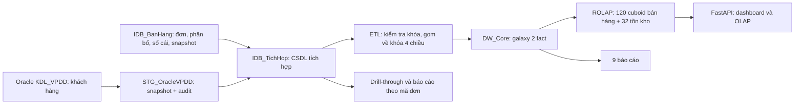
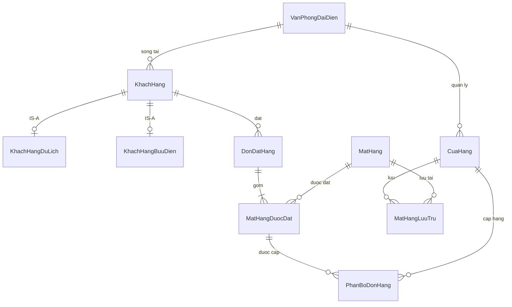
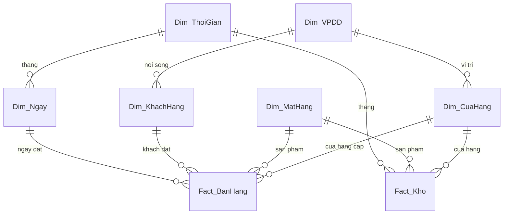

# BÁO CÁO BÀI TẬP LỚN KHO DỮ LIỆU — HỆ THỐNG ĐẶT HÀNG

## 1. Giới thiệu

Hệ thống tích hợp dữ liệu khách hàng và bán hàng để phân tích doanh thu, tồn kho và đáp ứng 9 báo cáo của đề. Yêu cầu bổ sung của giảng viên là lược đồ dải ngân hà (fact constellation), mỗi bảng fact tối thiểu 100.000 bản ghi, và khóa của fact là tổ hợp khóa ngoại tới mọi chiều mà người dùng muốn phân tích. Bản cài đặt tích hợp nguồn khách hàng trên Oracle 23.26.3.0.0 với nguồn bán hàng trên SQL Server, nạp galaxy qua IDB tích hợp và phục vụ FastAPI/giao diện web.

## 2. Yêu cầu nghiệp vụ

Khách có thể thuộc loại du lịch, bưu điện hoặc cả hai; mỗi khách sống ở một thành phố. Mỗi thành phố có một văn phòng đại diện quản lý nhiều cửa hàng. Cửa hàng lưu trữ nhiều mặt hàng. Một đơn có nhiều dòng hàng và một dòng có thể được cấp từ nhiều cửa hàng.

Đề yêu cầu phân tích lượng bán và tồn **theo từng cửa hàng** (YC1, 3, 5, 7, 8), theo thành phố và bang, theo khách hàng/loại khách, theo mặt hàng và theo thời gian tới **ngày đặt hàng** (YC2). Vì vậy mức chi tiết nhất được thiết kế vào fact là: ngày × khách hàng × mặt hàng × cửa hàng; các mức cao hơn có được bằng cuộn lên theo phân cấp.

Phân bổ xử lý đơn theo ngày, mã đơn rồi mã mặt hàng: dùng tồn dương trong cùng thành phố với khách trước, sau đó chuyển sang thành phố khác; mỗi lần cấp đều trừ tồn khả dụng. Nếu toàn mạng lưới thiếu hàng, bước phân bổ dừng lại thay vì ghi nhận cấp quá tồn. Thứ tự giữa các cửa hàng cùng ưu tiên là tồn giảm dần rồi mã cửa hàng, giúp tái lập kết quả.

Nguồn gốc không ghi cửa hàng thực hiện đơn và không có lịch sử tồn. Vì vậy demo bổ sung `PhanBoDonHang`, `BienDongKho`, `TonKhoThang` tại **nguồn**, rồi ETL các dữ kiện đó. Đây là giả lập nghiệp vụ có kiểm soát, không phải lịch sử thực thu thập được. Số tồn sinh ở bước đầu là tồn đầu kỳ ngày 01/01/2021 và cũng là mức tồn mục tiêu; đầu mỗi tháng, cặp cửa hàng–mặt hàng nào còn dưới 30% mức mục tiêu được nhập bổ sung lên đủ mức (`NHAP`). Tồn hiện tại và snapshot cuối tháng được tính xuôi từ sổ cái đầu kỳ/nhập/xuất. Chưa mô phỏng trả hàng.

Quy mô demo: 12 thành phố ở 8 bang, 50 cửa hàng, 100 mặt hàng, 5.000 khách, 55.000 đơn (115.500 dòng đơn), giai đoạn 2021–2023. Danh mục mỗi cửa hàng khoảng 70% số mặt hàng, chọn bằng băm MD5 nên có thành phố không bán một vài mặt hàng; đơn của khách ở đó được cấp từ thành phố khác.

## 3. Đặc tả chức năng và kiến trúc

Đầu vào: Oracle `FREEPDB1`, schema `KDL_VPDD` gồm khách hàng và hai bảng loại khách (demo SQL-only dùng `IDB_VPDD`); `IDB_BanHang` gồm văn phòng, cửa hàng, sản phẩm, tồn, đơn và dòng đơn cùng dữ liệu phân bổ/sổ cái bổ sung. Đầu ra: `IDB_TichHop`, `DW_Core`, 152 cuboid trong `OLAP_QuanLyBanHang`, dashboard, 9 báo cáo, thao tác OLAP.

Các fact/dimension và mô hình galaxy nằm ở tầng lưu trữ kho. Tầng OLAP dùng các cuboid SQL đã tổng hợp để phục vụ truy vấn đa chiều; không cần cài một dịch vụ SSAS riêng cho cách hiện thực ROLAP này.

## 4. Thiết kế kho dữ liệu

### 4.1. EER tích hợp hai nguồn

Chuyên biệt hóa khách hàng là **overlapping**: cùng mã KH có thể xuất hiện ở cả hai subtype. Mã thành phố và mã KH liên kết xuyên hai CSDL được kiểm tra khi nạp, không giả định có FK xuyên CSDL. Giữ riêng vai trò thành phố nơi khách sống và nơi cửa hàng hoạt động.

### 4.2. Bảng fact, khóa và lược đồ dải ngân hà

Mỗi bảng fact gồm hai phần: **khóa** là tổ hợp khóa ngoại tới mọi chiều phân tích, và **độ đo**.

| Fact | Khóa (tổ hợp khóa ngoại) | Độ đo và tính cộng | Số dòng demo |
|---|---|---|---|
| Fact_BanHang | ngay_key + kh_key + mh_key + ch_key | so_luong, doanh_thu: cộng được theo mọi chiều | ≥ 100.000 |
| Fact_Kho | time_key (tháng) + ch_key + mh_key | so_luong tồn: cộng theo cửa hàng/mặt hàng, không cộng theo thời gian | ≥ 100.000 |

`ch_key` trong Fact_BanHang là **cửa hàng thực cấp hàng**. Một dòng đơn được cấp từ hai cửa hàng tạo hai dòng fact, nên doanh thu theo cửa hàng, thành phố, bang luôn đúng và không bị nhân bản. Mã đơn không phải chiều phân tích nên không nằm trong khóa fact; báo cáo theo từng mã đơn và drill-through đọc tầng IDB tích hợp.

Hai fact dùng chung ba chiều Thời gian, Mặt hàng và Vị trí, nên có thể drill-across (đặt doanh số cạnh tồn kho của cùng thành phố trong cùng kỳ). Thời gian và vị trí được chuẩn hóa thành nhánh (`Dim_Ngay → Dim_ThoiGian`, `Dim_CuaHang → Dim_VPDD`); đây là galaxy có các nhánh snowflake.

Phân cấp:

| Chiều | Phân cấp |
|---|---|
| Thời gian | ngày → tháng → quý → năm → ALL (tồn kho bắt đầu từ tháng) |
| Vị trí | cửa hàng → thành phố → bang → ALL |
| Khách hàng | khách hàng → loại khách → ALL |
| Mặt hàng | mặt hàng → ALL |

Nguồn không có thông tin quốc gia nên bang là mức cao nhất trước ALL (toàn doanh nghiệp).

### 4.3. Ánh xạ ETL và giả định

| Nguồn (IDB_TichHop) | Đích | Xử lý |
|---|---|---|
| Văn phòng, cửa hàng, mặt hàng | Dim_VPDD, Dim_CuaHang, Dim_MatHang | giữ mã nghiệp vụ dạng chuỗi và thuộc tính mô tả |
| Khách + subtype du lịch/bưu điện | Dim_KhachHang | LEFT JOIN theo mã; hai cờ độc lập; CaHai khi cả hai cờ bật |
| Khoảng tháng của đơn và snapshot | Dim_ThoiGian, Dim_Ngay | lịch liên tục; ngày YYYYMMDD, tháng YYYYMM; quý từ tháng |
| PhanBoDonHang ⨝ MatHangDuocDat ⨝ DonDatHang | Fact_BanHang | GROUP BY ngày đặt, khách, mặt hàng, cửa hàng cấp; so_luong = SUM(lượng cấp); doanh_thu = SUM(lượng cấp × giá đặt) |
| TonKhoThang | Fact_Kho | sao chép snapshot có nguồn gốc sổ cái |

Demo dùng khóa nghiệp vụ làm khóa dimension, dimension kiểu SCD1 và full refresh; chưa bảo toàn lịch sử thay đổi địa chỉ/giá như SCD2. ETL DW nằm trong transaction với XACT_ABORT; lỗi khóa khiến nạp thất bại. Không tự thay mã thiếu hoặc loại bỏ dòng lỗi để làm khớp tổng.

## 5. Cài đặt các khối dữ liệu

Chế độ Oracle: `oracle/start_oracle.ps1`, sau đó `sql/run_oracle_pipeline.ps1` trích xuất Oracle → staging → IDB → DW → cuboid → kiểm thử; không seed lại nguồn. Chế độ SQL-only: `sql/run_all.ps1 -ResetDemo` chạy nguồn → `allocate_orders.py` (phân bổ, nhập/xuất, snapshot) → IDB → DW → sinh và vật hóa cuboid → metadata/index → đối chiếu. Dừng khi sqlcmd/Python có mã thoát lỗi. Xem `SETUP.md`.

Số khối = tích (số mức + 1) của từng chiều:

- Sales cube: Thời gian (5) × Mặt hàng (2) × Khách hàng (3) × Vị trí (4) = **120**.
- Inventory cube: Thời gian (4) × Mặt hàng (2) × Vị trí (4) = **32**.

`dw-dm/cube_schema.py` là định nghĩa duy nhất của chiều và phân cấp; `scripts/gen_cuboids.py` sinh `dw-dm/create_cuboids_vi.sql`, API và bộ kiểm tra dùng chung định nghĩa này.

Tồn cuối năm/quý là snapshot tháng cuối trong kỳ, theo từng cửa hàng–mặt hàng trước khi tổng hợp. Khi lọc quý 2 nhưng hiển thị năm, phải lấy tồn cuối quý 2, không lấy cuối năm và không cộng ba snapshot. Không có bộ lọc thì API dùng cuboid đã vật hóa tương ứng; có lọc dùng snapshot chi tiết để giữ đúng ngữ nghĩa cuối kỳ.

## 6. Các báo cáo và thao tác trực tuyến

| YC | Kết quả / nguồn chính | API |
|---|---|---|
| 1 | cửa hàng, thành phố, bang, điện thoại, mô tả/kích cỡ/trọng lượng/giá mặt hàng có kinh doanh (DW) | /api/bao-cao/1 |
| 2 | mã đơn, khách, ngày đặt (IDB) | /api/bao-cao/2?kh=1 |
| 3 | cửa hàng có bán các mặt hàng khách từng đặt (DW) | /api/bao-cao/3?kh=1 |
| 4 | văn phòng/thành phố/bang của cửa hàng có tồn mới nhất vượt ngưỡng (DW) | /api/bao-cao/4?mh=1&muc=100 |
| 5 | mặt hàng trong đơn, cửa hàng được phân bổ và các cửa hàng có kinh doanh mặt hàng (IDB) | /api/bao-cao/5?ma_don=1 |
| 6 | thành phố/bang nơi khách sống (DW) | /api/bao-cao/6?kh=1 |
| 7 | tồn mới nhất theo cửa hàng ở một thành phố (DW) | /api/bao-cao/7?mh=1&tp=1 |
| 8 | dòng đơn, lượng đặt, khách, cửa hàng cấp và lượng cấp (IDB) | /api/bao-cao/8?ma_don=1 |
| 9 | khách du lịch, bưu điện hoặc cả hai (DW) | /api/bao-cao/9?loai=ca_hai |

YC1/3/5 hiểu "có bán" là cặp cửa hàng–mặt hàng có trong danh mục lưu kho, kể cả tồn hiện tại bằng 0. YC2/5/8 là tra cứu theo mã đơn; mã đơn không thuộc khóa fact nên các báo cáo này đọc `IDB_TichHop`, cùng nguồn mà ETL dùng để nạp kho.

Dashboard hỗ trợ roll-up và drill-down theo phân cấp thời gian và vị trí, slice, dice, pivot giữa hai chiều bất kỳ (năm, loại khách, mặt hàng, bang), drill-across doanh số–tồn kho theo thời gian và vị trí, drill-through xuống từng lần cấp hàng. Các cuboid chi tiết có hơn 100.000 nhóm nên API trả theo trang (mặc định 2.000 dòng) và báo tổng số nhóm. Giao diện truy cập `/` và `/bao-cao`.

## 7. Kiểm tra tính đúng đắn

`validate_olap.py` đối chiếu toàn bộ hàng của 152 cuboid với truy vấn trực tiếp trên nguồn; thêm các kiểm tra sổ cái → snapshot, phân bổ → Fact_BanHang theo khóa 4 chiều, tổng fact = tổng dòng đơn, đủ lượng đặt, snapshot → Fact_Kho, tồn cuối, không âm theo từng sự kiện, và mỗi fact ≥ 100.000 dòng. Dùng Decimal cho tiền. `validate_reports.py` đối chiếu từng hàng của 9 báo cáo với truy vấn nguồn. `test_api.py` gọi mọi cuboid của hai lưới, các thao tác OLAP, pivot đảo chiều, roll-up vị trí giữ nguyên tổng, báo cáo 1–9 và tồn cuối quý khi hiển thị năm. `validate_idb.py` kiểm tra IDB, metadata, index và khóa Fact_BanHang đúng bằng 4 khóa ngoại. Kết quả ghi trong `KIEM_THU.md`.

## 8. Kết luận

Đã hiện thực pipeline Oracle + SQL Server, IDB tích hợp, galaxy hai fact có khóa là tổ hợp khóa ngoại các chiều, hai cube với 152 cuboid, 9 báo cáo và API OLAP. Fact bán hàng ở mức ngày × khách × mặt hàng × cửa hàng cho phép phân tích tới từng cửa hàng và cuộn lên thành phố, bang. Bổ sung nguồn phân bổ/sổ cái giúp kiểm tra được tồn theo thời gian và tránh cấp hàng vượt tồn. Dữ liệu là demo, full refresh/SCD1; chưa có tải tăng dần và trả hàng.
