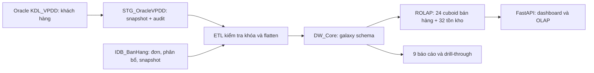
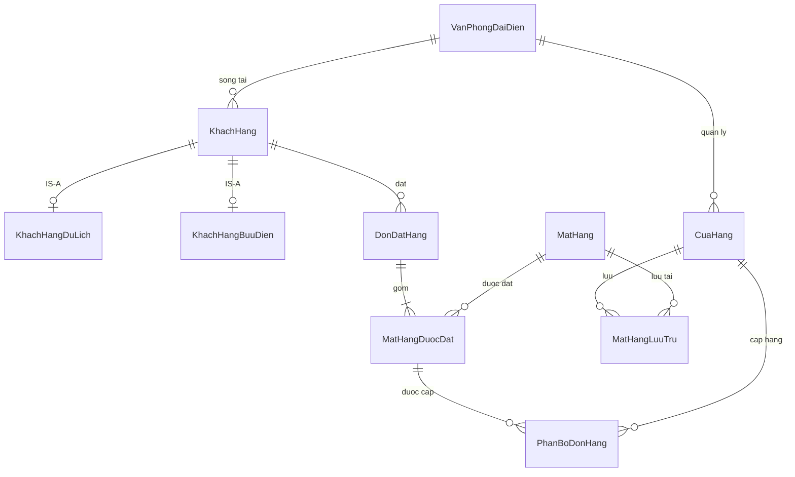
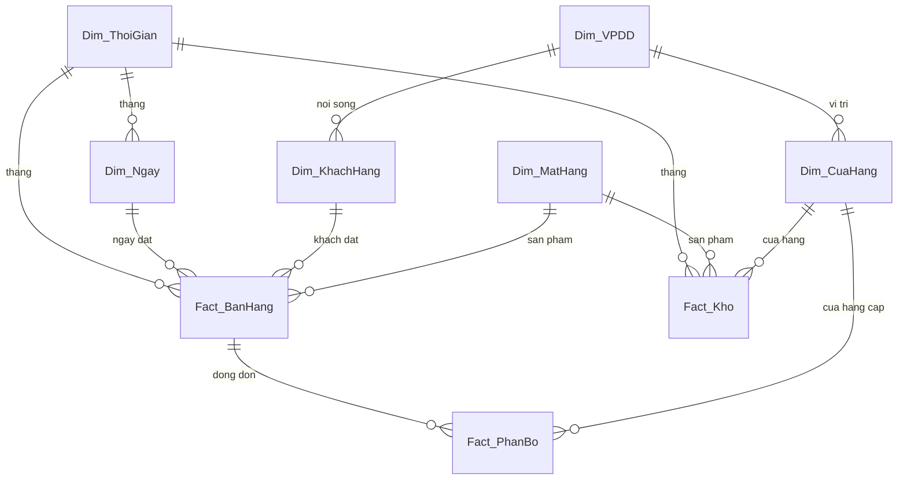

# BÁO CÁO BÀI TẬP LỚN KHO DỮ LIỆU — HỆ THỐNG ĐẶT HÀNG

## 1. Giới thiệu

Hệ thống tích hợp dữ liệu khách hàng và bán hàng để phân tích doanh thu, tồn kho và đáp ứng 9 báo cáo của đề. Yêu cầu bổ sung của giảng viên là lược đồ dải ngân hà (fact constellation). Bản cài đặt tích hợp nguồn khách hàng trên Oracle 23.26.3.0.0 với nguồn bán hàng trên SQL Server, nạp galaxy qua staging và phục vụ FastAPI/giao diện web. Pipeline Oracle đã trích xuất, nạp và đối chiếu dữ liệu thực tế; xem ORACLE.md và log kiểm thử.

## 2. Yêu cầu nghiệp vụ

Khách có thể thuộc loại du lịch, bưu điện hoặc cả hai; mỗi khách sống ở một thành phố. Mỗi thành phố có một văn phòng đại diện quản lý nhiều cửa hàng. Cửa hàng lưu trữ nhiều mặt hàng. Một đơn có nhiều dòng hàng và một dòng có thể được cấp từ nhiều cửa hàng.

Phân bổ xử lý đơn theo ngày, mã đơn rồi mã mặt hàng: dùng tồn dương trong cùng thành phố trước, sau đó chuyển sang thành phố khác; mỗi lần cấp đều trừ tồn khả dụng. Nếu toàn mạng lưới thiếu hàng, giao dịch tạo dữ liệu phân bổ thất bại thay vì ghi nhận cấp quá tồn. Thứ tự giữa các cửa hàng cùng ưu tiên là tồn giảm dần rồi mã cửa hàng, giúp tái lập kết quả.

Nguồn gốc không ghi cửa hàng thực hiện đơn và không có lịch sử tồn. Vì vậy demo bổ sung `PhanBoDonHang`, `BienDongKho`, `TonKhoThang` tại **nguồn**, rồi ETL các dữ kiện đó. Đây là giả lập nghiệp vụ có kiểm soát, không phải lịch sử thực thu thập được. Số tồn sinh ở bước đầu được hiểu là tồn mở đầu ngày 01/01/2021; demo không mô phỏng nhập bổ sung hoặc trả hàng. Tồn hiện tại và snapshot cuối tháng được tính xuôi từ ledger đầu kỳ/xuất kho, không suy ngược từ doanh thu.

## 3. Đặc tả chức năng và kiến trúc

Đầu vào: Oracle `FREEPDB1`, schema `KDL_VPDD` gồm khách hàng và hai bảng loại khách (demo SQL-only vẫn hỗ trợ `IDB_VPDD`); `IDB_BanHang` gồm văn phòng, cửa hàng, sản phẩm, tồn, đơn và dòng đơn cùng dữ liệu phân bổ/ledger bổ sung. Đầu ra: `DW_Core`, 56 cuboid trong `OLAP_QuanLyBanHang`, dashboard, 9 báo cáo, thao tác OLAP.

Các fact/dimension và mô hình galaxy nằm ở tầng lưu trữ kho. Tầng OLAP dùng các cuboid SQL đã tổng hợp để phục vụ truy vấn đa chiều; không cần cài một dịch vụ SSAS riêng cho cách hiện thực ROLAP này.

## 4. Thiết kế kho dữ liệu

### 4.1. EER tích hợp hai nguồn

Chuyên biệt hóa khách hàng là **overlapping**: cùng mã KH có thể xuất hiện ở cả hai subtype. Mã thành phố và mã KH liên kết xuyên hai CSDL được kiểm tra khi nạp, không giả định có FK xuyên CSDL. Giữ riêng vai trò thành phố nơi khách sống và nơi cửa hàng hoạt động.

### 4.2. Grain và lược đồ dải ngân hà

| Fact | Grain / khóa | Measure và tính cộng |
|---|---|---|
| Fact_BanHang | mã đơn × mặt hàng | số lượng, thành tiền cộng được; giá đặt không SUM |
| Fact_PhanBo | mã đơn × mặt hàng × cửa hàng | số lượng cấp cộng được |
| Fact_Kho | tháng × cửa hàng × mặt hàng | số lượng tồn cộng theo cửa hàng/sản phẩm, không cộng theo thời gian |

Hai fact phân tích chính dùng chung thời gian và mặt hàng, kết hợp fact phân bổ để giữ đúng quan hệ đơn–cửa hàng. Không đặt `ch_key` duy nhất vào dòng bán hàng vì dòng đơn có thể tách cấp. Không SUM doanh thu sau khi nối bán hàng với phân bổ: phép nối có thể nhân bản thành tiền. Địa lý được chuẩn hóa chung qua `Dim_VPDD`; đây là galaxy có các nhánh snowflake.

### 4.3. Ánh xạ ETL và giả định

| Nguồn | Đích | Xử lý |
|---|---|---|
| Văn phòng, cửa hàng, mặt hàng | Dim_VPDD, Dim_CuaHang, Dim_MatHang | giữ mã nghiệp vụ dạng chuỗi và thuộc tính mô tả |
| Khách + subtype du lịch/bưu điện | Dim_KhachHang | LEFT JOIN theo mã; hai cờ độc lập; CaHai khi cả hai cờ bật |
| Ngày đặt và tháng snapshot | Dim_Ngay, Dim_ThoiGian | ngày YYYYMMDD, tháng YYYYMM; quý từ tháng |
| Đơn và dòng đơn | Fact_BanHang | giữ mã đơn/ngày/khách; thành tiền = số lượng × giá đặt |
| PhanBoDonHang | Fact_PhanBo | sao chép cửa hàng thực cấp và số lượng |
| TonKhoThang | Fact_Kho | sao chép snapshot có nguồn gốc ledger |

Demo dùng khóa nghiệp vụ làm khóa dimension, dimension kiểu SCD1 và full refresh; chưa bảo toàn lịch sử thay đổi địa chỉ/giá như SCD2. ETL DW nằm trong transaction với XACT_ABORT; lỗi khóa khiến nạp thất bại. Không tự thay mã thiếu hoặc loại bỏ dòng lỗi để làm khớp tổng.

## 5. Cài đặt các khối dữ liệu

Chế độ Oracle: `oracle/start_oracle.ps1`, sau đó `sql/run_oracle_pipeline.ps1` trích xuất Oracle → staging → DW → cuboid → kiểm thử; không seed lại nguồn. Chế độ SQL-only: `sql/run_all.ps1` chạy nguồn → `01b_inventory_source.sql` → `02_etl_dw_core.sql` → tạo 56 cuboid → đối chiếu. Dừng khi sqlcmd/Python có mã thoát lỗi. Xem `SETUP.md` cho lệnh chạy và điều kiện reset demo.

Sales cube có Thời gian (tất cả/năm/quý/tháng) × Mặt hàng (tất cả/mặt hàng) × Khách hàng (tất cả/loại/khách) = **24**. Inventory cube có Thời gian × Mặt hàng × Vị trí (tất cả/bang/thành phố/cửa hàng) = **32**. Fact_PhanBo phục vụ báo cáo nghiệp vụ, không tạo một bộ cuboid thứ ba. Hai phân cấp cùng thời gian không phải hai chiều độc lập.

Tồn cuối năm/quý là snapshot tháng cuối trong kỳ, theo từng cửa hàng–mặt hàng trước khi tổng hợp. Khi lọc quý 2 nhưng hiển thị năm, phải lấy tồn cuối quý 2, không lấy cuối năm và không cộng ba snapshot. Không có bộ lọc thì API dùng cuboid đã vật hóa tương ứng; có lọc dùng snapshot chi tiết để giữ đúng ngữ nghĩa cuối kỳ.

## 6. Các báo cáo và thao tác trực tuyến

| YC | Kết quả / nguồn chính | API |
|---|---|---|
| 1 | cửa hàng, thành phố, bang, điện thoại, mô tả/kích cỡ/trọng lượng/giá mặt hàng có kinh doanh | /api/bao-cao/1 |
| 2 | mã đơn, khách, ngày đặt | /api/bao-cao/2?kh=1 |
| 3 | cửa hàng có bán các mặt hàng khách từng đặt | /api/bao-cao/3?kh=1 |
| 4 | văn phòng/thành phố/bang của cửa hàng có tồn mới nhất vượt ngưỡng | /api/bao-cao/4?mh=1&muc=100 |
| 5 | mặt hàng trong đơn, cửa hàng được phân bổ và các cửa hàng có kinh doanh mặt hàng | /api/bao-cao/5?ma_don=1 |
| 6 | thành phố/bang nơi khách sống | /api/bao-cao/6?kh=1 |
| 7 | tồn mới nhất theo cửa hàng ở một thành phố | /api/bao-cao/7?mh=1&tp=1 |
| 8 | dòng đơn, lượng đặt, khách, cửa hàng cấp và lượng cấp | /api/bao-cao/8?ma_don=1 |
| 9 | khách du lịch, bưu điện hoặc cả hai | /api/bao-cao/9?loai=ca_hai |

YC1/3/5 hiểu “có bán” là cặp cửa hàng–mặt hàng có trong danh mục lưu kho, kể cả tồn hiện tại bằng 0. YC5 có thể có nhiều dòng cho một dòng đơn do kết hợp danh sách nơi cấp và nơi kinh doanh; không cộng số lượng cấp trên toàn kết quả YC5. YC8 phản ánh grain phân bổ; số lượng đặt lặp lại theo cửa hàng, tổng lượng cấp mới là số cộng được.

Dashboard hỗ trợ roll-up, drill-down, slice, dice, pivot, drill-across và drill-through. Pivot mặt hàng/năm hoạt động theo cả hai hướng. Drill-through bán hàng giữ mã đơn và ngày cụ thể; drill-through kho lọc theo năm/quý/tháng. Giao diện truy cập `/` và `/bao-cao`; React tùy chọn mở cùng giao diện, không là một hệ thống API riêng.

## 7. Kiểm tra tính đúng đắn

`validate_olap.py` đối chiếu toàn bộ hàng kết quả của 56 cuboid với truy vấn nguồn; thêm 6 phép kiểm tra ledger→snapshot, dòng đơn→fact, phân bổ→fact, đủ lượng đặt, tồn cuối và không âm theo từng sự kiện. Dùng Decimal cho tiền. `validate_reports.py` đối chiếu từng hàng của 9 báo cáo với truy vấn nguồn tại bộ tham số kiểm thử. `test_api.py` chạy các tổ hợp trục, lỗi bộ lọc, pivot đảo chiều, báo cáo 1–9 và tồn cuối quý khi hiển thị năm. Kết quả và môi trường ghi trong `KIEM_THU.md`; không coi kiểm tra API trả 200 là bằng chứng riêng rằng mọi báo cáo đã đối chiếu đủ mọi tham số.

## 8. Kết luận

Đã hiện thực pipeline Oracle + SQL Server, galaxy ba fact với hai cube phân tích, 56 cuboid, 9 báo cáo và API OLAP. Bổ sung nguồn phân bổ/ledger giúp kiểm tra được tồn theo thời gian và tránh cấp hàng vượt tồn. Dữ liệu là demo, full refresh/SCD1; chưa có tải tăng dần và nhập/trả hàng. Oracle được bootstrap từ bộ dữ liệu demo ban đầu; từ đó extraction dùng Oracle làm nguồn khách hàng có thẩm quyền. Kiểm thử thay đổi tên tiếng Việt tại Oracle đã xác minh dữ liệu đi tới DW, và kiểm thử khóa thành phố sai xác minh staging rollback.
